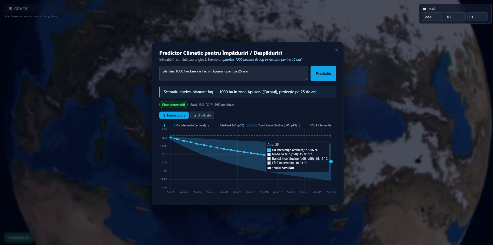

# SylvaCast

An interactive 3D globe for exploring historical weather and estimating the **local climate effect of planting or clearing forest in Romania**, described in plain Romanian or English.

> Bachelor's thesis project — Computer Science, "1 Decembrie 1918" University of Alba Iulia.



## What it does

- **3D globe** (Three.js) with a different NASA Blue Marble texture for each month.
- **Historical weather lookup**: click a city, pick a date, get the average temperature, humidity and weather condition for that day (Open-Meteo archive + OpenStreetMap geocoding).
- **Climate history chart**: daily max temperature and mean humidity for any location and period (Chart.js).
- **Forestation scenarios**: type something like
  *"plantez 10 hectare de stejar lângă Alba Iulia, cum se schimbă vremea în 5 ani?"* or
  *"Clear-cut 200 hectares of spruce in Maramureș, 10 year impact"*
  and get a year-by-year projection of local temperature and humidity change, with an uncertainty band.

## How the scenario engine works

```
user text ──► LLM parser ──► validated scenario ──► coefficient model ──► Monte Carlo ──► chart
             (Mistral 7B      (regex cross-checks     (literature-based     (1000 draws,
              via Ollama)      for action, area,       channels: ET          5th–95th
                               years, language)        cooling, albedo,      percentile)
                                                       roughness)
```

1. **Parsing** — a local LLM (Mistral 7B through Ollama) turns free text into structured JSON: action, area, location, sub-region, species, time horizon, and whether the request is in scope (forest planting/clearing inside Romania). Numbers, units and the action are re-extracted with regular expressions and take priority over the LLM output, so the model only has to judge scope and location. Romanian is supported with or without diacritics.
2. **Model** — a deterministic, modular model (`ai/ai_forestation_model.py`) combines three physical channels (evapotranspiration cooling, albedo warming, surface-roughness moderation) using coefficients taken from recent literature (`ai/ai_coefficients.py`), scaled by species, Romanian sub-region, patch size (saturating curve) and canopy growth over time. New intervention types can be added by registering another module in `ai/ai_intervention_base.py`.
3. **Uncertainty** — every coefficient has a low/high range; a Monte Carlo run samples them 1000 times and reports the 5th, 50th and 95th percentiles. If the final-year band crosses zero, the UI says the effect cannot be distinguished from natural variability.
4. **Baseline** — the last 3 years of observed data for the chosen location come from the Open-Meteo archive.

## Validation and limitations

`ai/ai_hindcast_runner.py` replays five documented clear-cuts in the Romanian Carpathians (2014–2018) and compares the model with what was actually observed in the following five years (`ai/hindcast_results.json`).

Result, stated plainly: the model predicts changes of a few hundredths of a degree, while observed year-to-year variation at those locations is 0.3–1.5 °C (overall MAE 0.49 °C). The predicted signal is far smaller than natural variability, and the gridded reanalysis data is too coarse to isolate the effect of a few hundred hectares. The hindcast therefore **cannot confirm or reject** the model. It shows that the effect, if real at this scale, is small.

Other limitations:
- Annual means only; no seasonal split.
- Local patch effect only, not regional or city-level climate.
- Some coefficients (e.g. the roughness channel) are conservative estimates where no study isolates the effect directly; see the notes returned with every prediction.
**Correction after thesis submission:** the albedo coefficient was originally set to +0.14 °C, which is the land-surface-temperature (LST) value from Li et al. rather than the converted air-temperature value. It is now +0.05 °C, the centre of the documented +0.02–0.08 °C range, consistent with how every other coefficient is chosen. This aligns the deterministic projection with the Monte Carlo median.

## Getting started

### Requirements

- Python 3.10 or newer
- Internet connection (weather data and map libraries are loaded online)
- *Optional, only for the scenario feature:* [Ollama](https://ollama.com) with the Mistral model (about 4 GB download)

### Quick start

```bash
git clone https://github.com/<your-username>/sylvacast.git
cd sylvacast
```

Then run **`run.bat`** on Windows or **`./run.sh`** on macOS/Linux. The script creates a virtual environment, installs the dependencies and starts the server. Open <http://127.0.0.1:5000>.

### Manual setup

```bash
python -m venv .venv
# Windows:  .venv\Scripts\activate
# macOS/Linux:  source .venv/bin/activate
pip install -r requirements.txt
python main.py
```

### Enabling the scenario feature

```bash
# install Ollama from https://ollama.com, then:
ollama pull mistral:7b-instruct
```

Keep Ollama running in the background. Everything else (globe, weather lookup, history chart) works without it. To use a different local model, set the `OLLAMA_MODEL` environment variable.

## Project structure

```
├── main.py                  Flask server and API routes
├── getweather.py            Open-Meteo + Nominatim clients
├── index.html               Frontend: Three.js globe, Chart.js charts, UI
├── ai/
│   ├── ai_scenario_parser.py    LLM + regex scenario parser
│   ├── ai_forestation_model.py  climate-effect model
│   ├── ai_coefficients.py       literature coefficients with ranges
│   ├── ai_monte_carlo.py        uncertainty estimation
│   ├── ai_orchestrator.py       end-to-end pipeline
│   ├── ai_hindcast_runner.py    validation against past clear-cuts
│   └── ai_test_*.py             manual check scripts
├── scripts/resize_textures.py   prepares the globe textures
└── textures/                    monthly Earth textures
```

The `ai_test_*.py` scripts print results for manual inspection (`python -m ai.ai_test_model`, `python -m ai.ai_test_monte_carlo`; the parser test needs Ollama).

## API

| Method | Route | Purpose |
|---|---|---|
| GET | `/get_weather?city=&date=YYYY-MM-DD` | Daily weather summary for a city |
| GET | `/api/climate-history?lat=&lon=&start=&end=&points=` | Sampled daily history |
| POST | `/api/forestation-scenario` `{"text": "...", "lat": ..., "lon": ...}` | Scenario projection |

## Tech stack

Python, Flask, Three.js, Chart.js, Ollama (Mistral 7B), Open-Meteo API, OpenStreetMap Nominatim.

## Credits

- Earth textures: NASA Visible Earth, Blue Marble Next Generation (2004).
- Weather data: [Open-Meteo](https://open-meteo.com) historical archive.
- Geocoding: [OpenStreetMap Nominatim](https://nominatim.org).
- Scientific sources for each coefficient are listed in `ai/ai_forestation_model.py` and returned by the API with every prediction.
